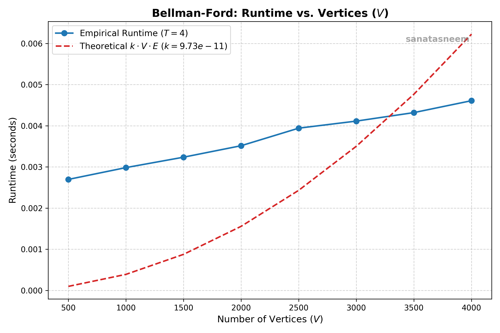
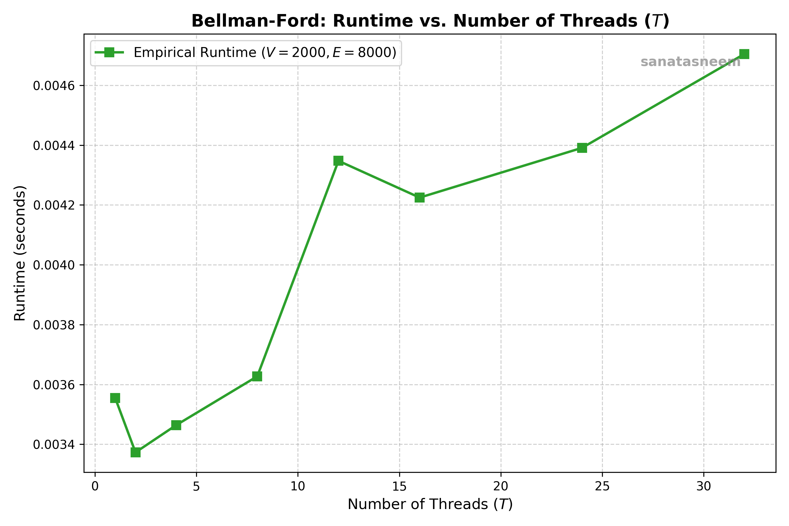

# OSN Mini Project 3 - Concurrency & xv6

## Overview

This repository contains the complete implementation and documentation for Operating Systems and Networks (OSN) Mini Project 3, covering:

1. **Airport Troubles (`concurrency/airport-troubles/`)**: Discrete-event multithreaded simulation of Gotham Intergalactic Airport arrivals using POSIX threads, mutexes, condition variables, and semaphores.
2. **Birthday Boy (`concurrency/birthday-boy/`)**: Multithreaded Bellman-Ford shortest path algorithm parallelized using POSIX threads and barrier synchronization, along with a comprehensive performance analysis report.
3. **Symbolic Links in xv6 (`xv6/`)**: Kernel support for symbolic links (`T_SYMLINK`, `symlink` system call, recursive symlink resolution in `open` with `O_NOFOLLOW`), and userspace utilities (`ln -s`, `readlink`).

---

## 1. Airport Troubles (`concurrency/airport-troubles`)

### Design & Synchronization Architecture
Every entity in the airport is modeled as an independent POSIX thread:
- **Students**: Each student is a thread that navigates the arrivals flow: entering the hall, scanning passport at one of 3 scanners (taking 2 time units), waiting for officer approval and receiving a stamp, leaving the hall, and collecting their bag from the conveyor belt.
- **Immigration Officer**: Thread representing the officer. Enters the hall, ensures no new students enter or leave, waits for all currently present students to finish scanning, approves everyone as a single batch, and departs without waiting for students to receive their stamps.
- **Baggage Handlers**: 2 handler threads that has a capacity of at most 2 bags. If the belt is full, handlers block until a student collects a bag.

### Compilation & Execution
```bash
gcc -Wall -Wextra -pthread -o airport-troubles concurrency/airport-troubles/main.c
./airport-troubles < input.txt
```

---

## 2. Birthday Boy (`concurrency/birthday-boy`)

### Parallel Bellman-Ford Implementation
- Vertices $[0, V - 1]$ are partitioned evenly across $T$ worker threads and weight of each edge is assumed to be 1.
- In each iteration $k \in [0, V - 2]$, each thread computes the updated shortest distances for its assigned slice of destination vertices by inspecting incoming edges from adjacent vertices.
- **Race-Free Design**: Distance arrays are double-buffered (`dist` and `new_dist`). Worker threads only read from `dist` and write exclusively to their assigned slice in `new_dist`.
- **Barrier Synchronization**: Two-phase barrier synchronization synchronizes rounds across threads and enables early termination when no updates occur across an entire round.

---

## Performance Analysis Report

### 1. Runtime vs. Number of Vertices ($V$)

To analyze algorithmic scalability, we measured the execution runtime as a function of the number of vertices $V$ with $E = 4V$ for a fixed thread count $T = 4$. For each data point, the runtime was averaged over multiple independently generated random graph topologies to eliminate structural variance.

The theoretical time complexity of Bellman-Ford is:
$$\mathcal{O}(V \cdot E)$$

We modeled the expected complexity as:
$$T_{\text{expected}}(V) = k \cdot V \cdot E$$

Using linear least-squares regression across empirical data points, the optimal constant of proportionality was determined to be:
$$k \approx 9.73 \times 10^{-11} \text{ seconds / (vertex} \times \text{edge)}$$



#### Analysis:
- The empirical runtime closely tracks the theoretical $k \cdot V \cdot E$ trajectory.
- As the graph size increases, each iteration requires inspecting all incident edges $\sum_{u} \deg(u) = 2E$, and the maximum number of iterations scales with graph diameter (bounded by $V - 1$).
- Minor discrepancies at smaller graph sizes are due to fixed setup costs (memory allocation, thread spawning, and barrier initialization) that are amortized over larger graph instances.

---

### 2. Runtime vs. Number of Threads ($T$)

We evaluated parallel speedup and scalability by fixing the graph dimensions ($V = 2000, E = 8000$) and varying the number of threads $T \in [1, 2, 4, 8, 12, 16, 24, 32]$. Runtimes were averaged across multiple random graph topologies for each thread count.



#### Observations & Discussion:
1. **Initial Speedup ($T = 1 \to 2$)**:
   - Transitioning from single-threaded execution to 2 threads yields a measurable speedup as the relaxation workload across the $V$ vertices is divided among concurrent physical CPU cores.
2. **Diminishing Returns & Synchronization Bottleneck ($T \ge 4$)**:
   - Beyond a small number of threads, the runtime plateaus and gradually increases.
   - **Barrier Synchronization Overhead**: In parallel Bellman-Ford, all $T$ threads must synchronize at a barrier after each relaxation round. With $V - 1$ possible rounds, threads spend more time contending for mutexes and condition variables inside `pthread_barrier_wait` than performing useful edge relaxation.
   - **Work Grain Size**: For $V = 2000$ and $T = 32$, each thread is responsible for only $\approx 62$ vertices per round. The computational work per slice is too small to outweigh thread coordination and context-switching overheads (Amdahl's Law).
   - **Cache Line Contention / False Sharing**: Multiple threads reading adjacent entries in the global distance arrays can cause cache invalidations across CPU cores, reducing memory bus efficiency.

### Compilation & Execution
```bash
gcc -Wall -Wextra -pthread -o birthday-boy concurrency/birthday-boy/main.c
./birthday-boy < input.txt
```
---

## 3. Symbolic Links in xv6 (`xv6/`)

### Kernel Modifications
- **Inode Type (`T_SYMLINK = 4`)**: Defined in `kernel/stat.h`.
- **`O_NOFOLLOW = 0x1000`**: Added in `kernel/fcntl.h` to allow opening symbolic links directly without dereferencing.
- **System Call `symlink(target, path)`**:
  - Implemented in `kernel/sysfile.c` (`sys_symlink`).
  - Creates a new inode of type `T_SYMLINK`, writes the target pathname into the inode's data blocks using `writei()`, and links it into the directory.
  - Allows dangling symlinks (the target is not required to exist).
  - Proper transaction handling via `begin_op()` and `end_op()`.
- **Symlink Resolution in `open()`**:
  - Automatically traverses symbolic link chains up to a maximum depth of 10 to prevent infinite loops caused by cyclic symlinks.
  - Returns `-1` on dangling links or cycles exceeding depth 10.
  - Correctly handles `O_CREATE` on existing symbolic links by writing through the link to the target file.
  - Respects `O_NOFOLLOW` to open the symlink itself (used by `readlink` and `symlinktest`).

### Userspace Utilities
- **`ln -s target path` (`user/ln.c`)**: Creates a symbolic link if `-s` is provided as the second argument, falling back to standard hard links otherwise.
- **`readlink path` (`user/readlink.c`)**: Opens the specified path with `O_NOFOLLOW`, validates that the file is of type `T_SYMLINK`, reads the target path from the inode data blocks, and outputs it to stdout.

### Testing & Verification
The kernel passes all validation test suites:
- `symlinktest`:
  - `test symlinks: ok`
  - `test O_CREATE on existing symlink: ok`
  - `test concurrent symlinks: ok`
- `usertests -q`:
  - `ALL TESTS PASSED`

