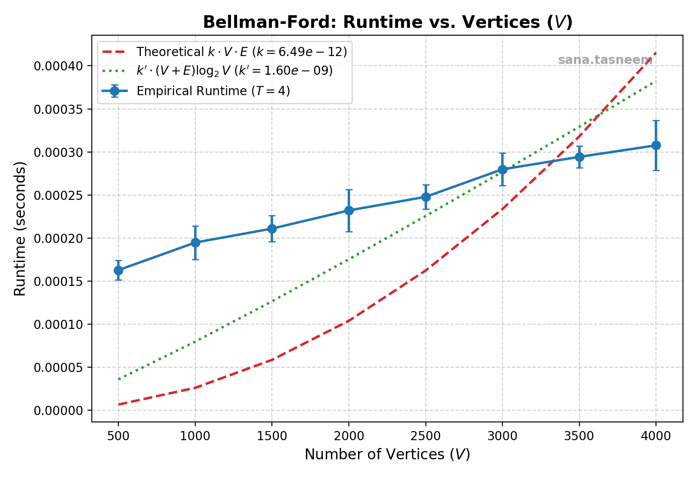
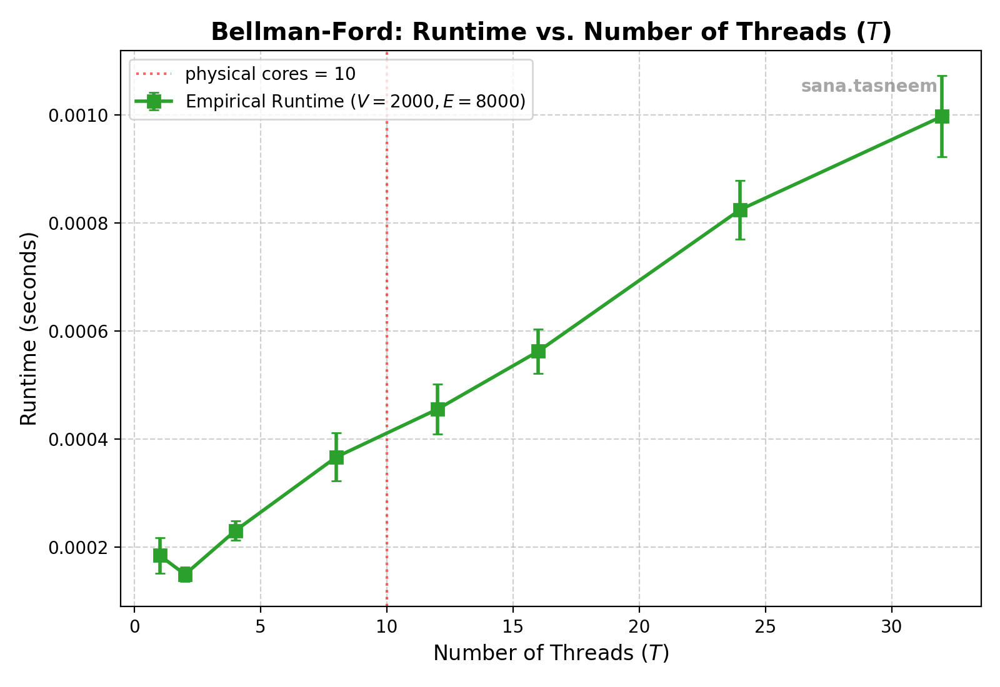

# OSN Mini Project 3 - Concurrency & xv6

## Overview

This repository contains the complete implementation and documentation for Operating Systems and Networks (OSN) Mini Project 3, covering:

1. **Airport Troubles (`concurrency/airport-troubles/`)**: Discrete-event multithreaded simulation of Gotham Intergalactic Airport arrivals using POSIX threads, mutexes, condition variables, and semaphores.
2. **Birthday Boy (`concurrency/birthday-boy/`)**: Multithreaded Bellman-Ford shortest path algorithm parallelized using POSIX threads and barrier synchronization, along with a comprehensive performance analysis report.
3. **Symbolic Links in xv6 (`xv6/`)**: Kernel support for symbolic links (`T_SYMLINK`, `symlink` system call, recursive symlink resolution in `open` with `O_NOFOLLOW`), and userspace utilities (`ln -s`, `readlink`).

---

## 1. Airport Troubles (`concurrency/airport-troubles`)

### Design & Synchronization Architecture
Every entity in the airport is modeled as an independent POSIX thread:
- **Students**: Each student is a thread that navigates the arrivals flow: entering the hall, scanning passport at one of 3 scanners (taking 2 time units), waiting for officer approval and receiving a stamp, leaving the hall, and collecting their bag from the conveyor belt.
- **Immigration Officer**: Thread representing the officer. Enters the hall, ensures no new students enter or leave, waits for all currently present students to finish scanning, approves everyone as a single batch, and departs without waiting for students to receive their stamps.
- **Baggage Handlers**: 2 handler threads that has a capacity of at most 2 bags. If the belt is full, handlers block until a student collects a bag.

### Compilation & Execution
```bash
gcc -Wall -Wextra -pthread -o airport-troubles concurrency/airport-troubles/main.c
./airport-troubles < input.txt
```

---

## 2. Birthday Boy (`concurrency/birthday-boy`)

### Parallel Bellman-Ford Implementation
- Vertices $[0, V - 1]$ are partitioned evenly across $T$ worker threads and weight of each edge is assumed to be 1.
- In each iteration $k \in [0, V - 2]$, each thread computes the updated shortest distances for its assigned slice of destination vertices by inspecting incoming edges from adjacent vertices.
- **Race-Free Design**: Distance arrays are double-buffered (`dist` and `new_dist`). Worker threads only read from `dist` and write exclusively to their assigned slice in `new_dist`.
- **Barrier Synchronization**: Two-phase barrier synchronization synchronizes rounds across threads and enables early termination when no updates occur across an entire round.

---


## Performance Analysis

### 1. Runtime vs. Number of Vertices (V)

To analyse how the runtime of the parallel Bellman-Ford algorithm varies with the number of vertices, experiments were conducted by varying V while keeping the number of threads fixed at T = 4.

For every combination of V and E, multiple graphs with different edge sets were tested, and the runtime was averaged to obtain representative measurements.

The theoretical time complexity of Bellman-Ford is O(VE), since the algorithm performs up to V-1 iterations, examining all E edges in each iteration.

Therefore, the theoretical runtime is represented by:

\[
T_{\text{theoretical}} = kVE
\]

The experimentally fitted constant is:

**k = 6.49 × 10⁻¹²**

An additional reference curve, k'(V + E)log₂V, is plotted for comparison, where:

**k' = 1.60 × 10⁻⁹**



**Observations:**

- The empirical runtime generally increases as the number of vertices increases.
- The theoretical kVE curve represents the expected growth in computational work.
- The empirical measurements do not perfectly match the theoretical curve because actual execution time is also affected by thread scheduling, synchronization and memory-access overhead.
- For smaller graphs, fixed overheads form a larger proportion of the total execution time.
- As the graph size increases, the computational work becomes more significant.

### 2. Runtime vs. Number of Threads (T)

To analyse the effect of parallelism, the number of threads was varied while keeping the graph size fixed at:

- **Number of vertices (V):** 2000
- **Number of edges (E):** 8000

For each thread count, multiple graphs with different edge sets were tested, and the runtime was averaged.

The system has 10 physical CPU cores, represented by the vertical dotted line in the plot.



**Observations:**

- Initially, increasing the number of threads reduces runtime because the workload is distributed across multiple threads.
- Beyond a certain point, adding more threads increases runtime instead of improving performance.
- This happens because each iteration requires synchronization between worker threads using barriers. All workers must finish their assigned work before the next iteration can begin.
- Creating and managing additional threads also introduces scheduling and context-switching overhead.
- The system has 10 physical CPU cores. When the number of threads exceeds the available physical cores, threads compete for CPU resources, potentially increasing execution time.
- For this graph size, the overhead of managing additional threads outweighs the benefits of parallel execution.

**Conclusion:**

The experiment demonstrates that increasing the number of threads does not necessarily improve performance. Parallelism initially reduces execution time, but synchronization and scheduling overhead eventually dominate.

The optimal number of threads depends on the graph size, workload and available hardware resources.

### 3. Overall Conclusion

The experiments demonstrate that:

- Runtime increases with graph size, consistent with the theoretical O(VE) complexity of Bellman-Ford.
- Increasing the number of threads can improve performance initially.
- Excessive parallelism introduces synchronization, scheduling and thread-management overhead.
- Efficient parallel execution requires balancing the workload against the number of available CPU cores.


---

### Compilation & Execution
```bash
gcc -Wall -Wextra -pthread -o birthday-boy concurrency/birthday-boy/main.c
./birthday-boy
```
---

## 3. Symbolic Links in xv6 (`xv6/`)

### Kernel Modifications
- **Inode Type (`T_SYMLINK = 4`)**: Defined in `kernel/stat.h`.
- **`O_NOFOLLOW = 0x1000`**: Added in `kernel/fcntl.h` to allow opening symbolic links directly without dereferencing.
- **System Call `symlink(target, path)`**:
  - Implemented in `kernel/sysfile.c` (`sys_symlink`).
  - Creates a new inode of type `T_SYMLINK`, writes the target pathname into the inode's data blocks using `writei()`, and links it into the directory.
  - Allows dangling symlinks (the target is not required to exist).
  - Proper transaction handling via `begin_op()` and `end_op()`.
- **Symlink Resolution in `open()`**:
  - Automatically traverses symbolic link chains up to a maximum depth of 10 to prevent infinite loops caused by cyclic symlinks.
  - Returns `-1` on dangling links or cycles exceeding depth 10.
  - Correctly handles `O_CREATE` on existing symbolic links by writing through the link to the target file.
  - Respects `O_NOFOLLOW` to open the symlink itself (used by `readlink` and `symlinktest`).

### Userspace Utilities
- **`ln -s target path` (`user/ln.c`)**: Creates a symbolic link if `-s` is provided as the second argument, falling back to standard hard links otherwise.
- **`readlink path` (`user/readlink.c`)**: Opens the specified path with `O_NOFOLLOW`, validates that the file is of type `T_SYMLINK`, reads the target path from the inode data blocks, and outputs it to stdout.

### Testing & Verification
The kernel passes all validation test suites:
- `symlinktest`:
  - `test symlinks: ok`
  - `test O_CREATE on existing symlink: ok`
  - `test concurrent symlinks: ok`
- `usertests -q`:
  - `ALL TESTS PASSED`

